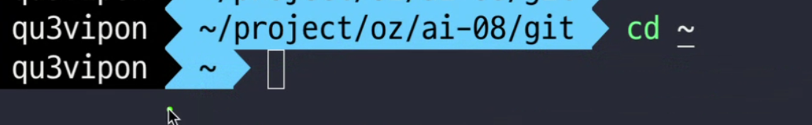
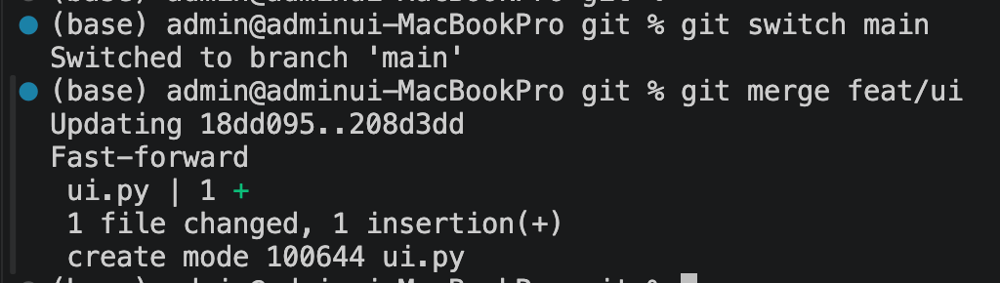
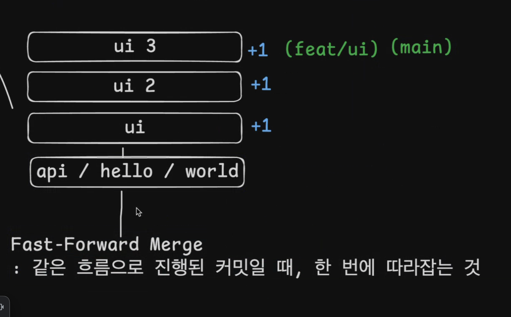
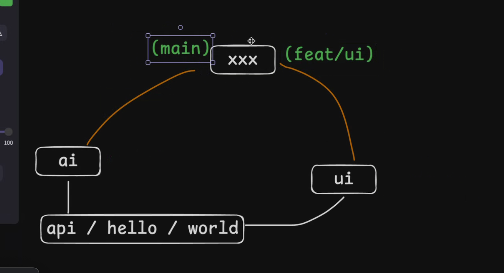
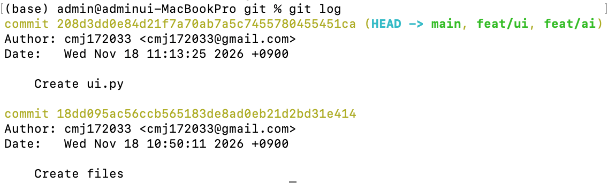
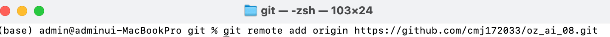
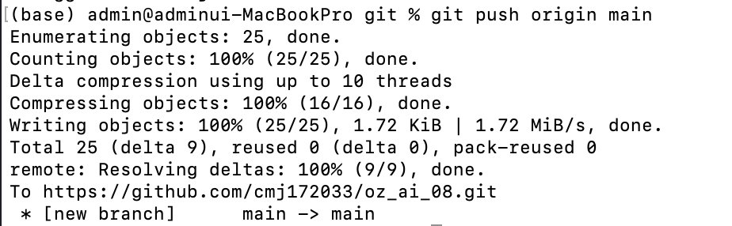

# Git 2일차

> 261118

---

## git을 사용하는 목적

**코드의 변경 이력을 관리 (버전 관리)**

→ **`.git/`** … (파일)에 여러 정보가 있음 (git에서 발생되는 모든 기록들)
- 비유: 일기. 어렸을 때 사진을 없앴다고 해서 나라는 사람이 없어지지 않음 → 깃도 마찬가지로 "변화된 기록"일 뿐이다.

---

## 작업 폴더 위치

**\*\*\* `~`(홈)라는 제일 하위 경로가 아닌, `git`이라는 폴더에서 작업하는 이유?**

→ `git init`이 `~`에서 실행되면 **모든 경로에 버전 관리가 적용**되어 버리기 때문에 문제가 된다.

---

## 기본 흐름

1. `git init`으로 초기화하기
2. `ui.py` 파일 생성
3. `git add ui.py`
4. `git commit -m "Create ui.py"`
   - commit 하려면 `git add`를 먼저 해야 함
   - `feat/ui`에서 `ui.py` 파일 수정 중 → `main`에는 영향 없음

⇒ 작업한 내용을 **main으로 옮기거나(merge) 삭제**하는 선택지가 있다.

→ main에서 feat을 받아들이는 것이므로 **main에서 merge** 한다.

---

## Merge

→ `main`으로 바꾸고 merge

### Fast-Forward Merge (기본 동작)

- 빨리 감기로 따라잡는 것 = **Fast-Forward Merge** (기본 동작)
- 항상 이런 방식으로만 되는 것은 아님 → 앞으로 마주하게 될 문제 …

### FF가 안 될 때

- 커밋을 하나 더 만들어서 **공통적인 커밋**을 만든다.
- 일반적으로 커밋은 (새로운 파일을 만드는 등) 변경사항을 가했을 때 하나의 버전을 만드는 것.
- 이때 만드는 커밋은 내용이 비어 있음 … 공통된 길을 만들어 주기 위한 커밋이므로 **병합 커밋(Merge Commit)** 이라고 함. (**3-way merge**)

---

## 브랜치 만들기

1. `git branch feat/ai`
   - 브랜치 생성
   - `main`, `feat/ui`, `feat/ai`가 같은 선상에 있는지 확인 필요

---

## 소스 코드와 오픈 소스

- **소스 코드 (Source Code)**: 프로그램을 돌리는 원천 코드
- **오픈 소스 (Open Source)**: 코드를 누구나 볼 수 있게 공유
  - Python, Git, Linux
  - pytorch, numpy, sqlite, vscode

---

## 원격 저장소에 업로드 (push)

업로드할 주소 등록 (터미널) / push 하는 것

